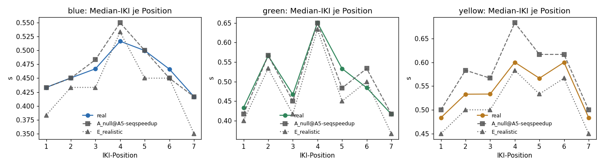

# Realismus-Check: Simulation vs. echte Daten

Echte Daten: Kalibrierung `configs/simulation/empirical_calibration.json` (400 Dateien). Simuliert: A_null@A5-seqspeedup (20 Dateien), E_realistic (60 Dateien).  
Alle Spalten wurden mit demselben Schätzer (`src/simulation/calibrate.estimate`) berechnet.

Lesehilfe: `A_null@A5-seqspeedup` enthält alle realistischen Störfaktoren, aber keine Chunks, und prüft den Realismus der Simulation direkt. Familien mit Chunk-Struktur (z. B. `E_realistic`) weichen bei Blue/Green absichtlich ab (Grenz-Spikes verlangsamen einzelne Positionen); Yellow muss dort weiterhin passen. `sd_between_files` ist in den meisten Familien absichtlich auf 50 % der echten Streuung gesetzt.

| Kennwert | echt | A_null@A5-seqspeedup | E_realistic |
|---|---|---|---|
| mu_log_iki | -0.661 | -0.727 | -0.896 |
| sd_between_files | 0.581 | 0.361 | 0.565 |
| sd_block | 0.178 | 0.175 | 0.185 |
| ar1_block | 0.184 | 0.209 | 0.190 |
| sd_residual | 0.330 | 0.308 | 0.364 |
| sd_residual_robust | 0.240 | 0.290 | 0.337 |
| tail_left_log | 0.472 | 0.490 | 0.606 |
| tail_right_log | 0.724 | 0.651 | 0.693 |
| lag1_within_block | -0.253 | -0.225 | -0.240 |
| post_error_slowing_log | 0.588 | 0.588 | 0.596 |
| first_press_log_mu | 1.415 | 1.415 | 1.416 |
| first_press_log_sd | 0.107 | 0.108 | 0.106 |
| sequence_offset[blue] | -0.205 | -0.203 | -0.171 |
| errors_per_block[blue] | 0.260 | 0.307 | 0.300 |
| frac_error_free[blue] | 0.854 | 0.834 | 0.841 |
| IKI q5 [blue] (s) | 0.117 | 0.217 | 0.133 |
| IKI q50 [blue] (s) | 0.467 | 0.467 | 0.433 |
| IKI q95 [blue] (s) | 1.150 | 1.100 | 1.417 |
| IKI q99 [blue] (s) | 1.750 | 1.617 | 2.133 |
| positional median [blue] (s) | 0.43 0.45 0.47 0.52 0.50 0.47 0.42 | 0.43 0.45 0.48 0.55 0.50 0.45 0.42 | 0.38 0.43 0.43 0.53 0.45 0.45 0.35 |
| sequence_offset[green] | -0.130 | -0.128 | -0.113 |
| errors_per_block[green] | 0.281 | 0.263 | 0.327 |
| frac_error_free[green] | 0.847 | 0.850 | 0.825 |
| IKI q5 [green] (s) | 0.117 | 0.233 | 0.150 |
| IKI q50 [green] (s) | 0.500 | 0.500 | 0.467 |
| IKI q95 [green] (s) | 1.217 | 1.217 | 1.400 |
| IKI q99 [green] (s) | 1.833 | 1.740 | 2.139 |
| positional median [green] (s) | 0.43 0.57 0.47 0.65 0.53 0.48 0.42 | 0.42 0.57 0.45 0.65 0.48 0.53 0.42 | 0.40 0.53 0.42 0.63 0.45 0.50 0.37 |
| sequence_offset[yellow] | 0.000 | 0.000 | 0.000 |
| errors_per_block[yellow] | 0.346 | 0.356 | 0.360 |
| frac_error_free[yellow] | 0.790 | 0.814 | 0.816 |
| IKI q5 [yellow] (s) | 0.150 | 0.283 | 0.183 |
| IKI q50 [yellow] (s) | 0.549 | 0.583 | 0.517 |
| IKI q95 [yellow] (s) | 1.283 | 1.400 | 1.517 |
| IKI q99 [yellow] (s) | 1.917 | 1.933 | 2.233 |
| positional median [yellow] (s) | 0.48 0.53 0.53 0.60 0.57 0.60 0.48 | 0.50 0.58 0.57 0.68 0.62 0.62 0.50 | 0.45 0.50 0.50 0.58 0.53 0.57 0.45 |

